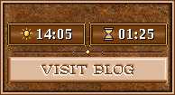
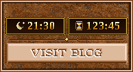

# Interface_AdventureInfoPanel

맵 화면 오른쪽 아래, 영웅 패널과 자원 바 사이의 빈 공간(1366x768 기준 194x105)에
**현재 시간 / 플레이 시간 / VISIT BLOG 버튼**을 표시하는 ERA 플러그인입니다. (H2 그래픽 모드용 디자인)

 

## 기능

| 항목 | 동작 |
|---|---|
| 현재 시간 | PC 시계 기준 `HH:MM`, 분이 바뀔 때만 다시 그림 |
| 낮/밤 | 06:00~17:59 나무판 + 흰 숫자 + 해, 18:00~05:59 어두운 홈 + 금박 숫자 + 달 (버튼 색은 항상 그대로) |
| 플레이 시간 | 맵을 시작한 순간부터 누적 `HH:MM` (100시간 넘으면 `123:45`, 최대 `999:59`) |
| 저장/불러오기 | 저장할 때 누적 시간을 세이브 파일에 기록, 불러오면 그 값부터 다시 누적 |
| 리스타트 | 0부터 다시 시작 |
| 마우스 오버 | 하단 힌트 바(자원 표시 바로 위 줄)에 ERT 202785 / 202786 / 202787 |
| 우클릭 | 같은 문구를 H3 기본 팝업으로 (버튼은 이동할 주소도 함께 표시) |
| VISIT BLOG | 누르면 눌린 모양, 버튼 위에서 떼면 ERT 202784 주소를 기본 브라우저로 엶 (누른 채 밖에서 떼면 취소) |

화면에 105px 공간이 없는 해상도(예: 800x600)에서는 패널을 만들지 않습니다.

## 사용하는 ERT

`Data/s/The Multiverse - 10. Hint.ert` 를 먼저 읽고, 없는 번호는 `Data/s/*.ert`, `Mods/*/Data/s/*.ert` 에서 찾습니다.
그래도 없으면 코드에 넣어 둔 기본 문구를 씁니다.

```
202782	현재 시간
202783	플레이 시간
202784	https://heroesdeathstare.blogspot.com/
202785	플레이어가 위치한 지역의 현재 시간
202786	현재 맵을 플레이한 누적 시간
202787	개발자의 블로그를 방문하여 더 많은 정보를 탐색합니다.
```

> 202784 는 `http://` 또는 `https://` 로 시작하는 주소만 엽니다.

## 설치

1. `H3EraPlugins.sln` 에서 **Interface_AdventureInfoPanel** 을 `Release | x86` 로 빌드
2. `Interface_AdventureInfoPanel\Release\adventure_info_panel.era` → `Mods\<모드>\eraplugins\`
3. `Interface_AdventureInfoPanel\Data\` 의 파일 5개 → `Mods\<모드>\Data\`

| 파일 | 크기 | 내용 |
|---|---|---|
| `DsIpBg.pcx` | 194x105 | 배경 (H2 돌판, 얇은 테두리, 구분선) |
| `DsIpPlq.def` | 87x26 | 명판 0 낮 / 1 밤 |
| `DsIpIco.def` | 15x20 | 0 해 / 1 달 / 2 모래시계(낮) / 3 모래시계(밤) |
| `DsIpDgt.def` | 9x20 | 숫자 0~9, `:` — 그룹 0 낮(흰색), 그룹 1 밤(금박) |
| `DsIpBtn.def` | 178x29 | VISIT BLOG 0 일반 / 1 눌림 |

모든 DEF 프레임은 배경까지 합성된 불투명 그림이라 투명색/특수색(팔레트 0~7)을 쓰지 않습니다.

## 구조

| 파일 | 역할 |
|---|---|
| `dllmain.cpp` | 패처 인스턴스 생성, ERA 이벤트 등록, 게임 초기화 후 후킹 설치 |
| `InfoPanel.*` | 패널 생성/그리기/입력 처리 |
| `InfoPanelLayout.h` | 좌표·리소스 이름·항목 번호 (그림과 반드시 같은 값) |
| `PlayTime.*` | 누적 시간 계산, 세이브 섹션 `DeathStare.AdventureInfoPanel.PlayTime` |
| `ErtText.*` | ERT 문구 읽기 |
| `asset_tools/make_assets.py` | DEF/PCX 생성기 (Python 3 + Pillow) |
| `asset_tools/verify_assets.py` | 만든 DEF/PCX 를 게임 방식으로 다시 읽어 패널을 조립해 보는 검증 도구 |

패널 전체를 194x105 캔버스(`H3LoadedPcx16`) 하나에 그리고, 모험 지도 대화상자에는 그 캔버스를 보여주는
`H3DlgPcx16` 항목 1개(ID 27180)만 붙입니다. 클릭·힌트는 좌표로 직접 판정합니다.

### 사용한 후킹 (모두 저장소의 기존 플러그인에서 이미 쓰고 있는 위치)

| 주소 | 종류 | 용도 | 참고한 코드 |
|---|---|---|---|
| `0x4EEAF2` | LoHook | 게임 초기화 후 후킹 설치 | Interface_EnhancedCreatureInformation |
| `0x40730F` | LoHook | 모험 지도 표시 → 패널 항목 생성 | GraphicsEnhancements (`AdventureManager_Show`) |
| `0x408710` | HiHook | 모험 지도 메시지: 클릭/우클릭, 입력 없을 때 시계 갱신 | MapScroller (`AdvMgr_MapScreenProcedure`) |
| `0x40EB47`, `0x40E1CC` | HiHook | 마우스 오버 힌트 | MithrilDisplay (`MoveHint`) |
| `0x40B040` | 호출 | 하단 힌트 바 문구 설정 | MithrilDisplay |

### 플레이 시간 이벤트 흐름

```
새 게임 / 리스타트 : OnAfterErmInstructions → 0 부터     (OnGameEnter 에서도 한 번 더 0 확인)
불러오기           : OnSavegameRead(값 읽기) → OnGameEnter 에서 그 값부터
저장               : OnSavegameWrite → 현재 누적값 기록
메인 메뉴로 나감   : OnGameLeave → 멈춤
```

## 그림을 바꾸고 싶을 때

1. `asset_tools/make_assets.py` 의 색/모양 수정 (좌표를 바꾸면 `InfoPanelLayout.h` 도 같이 수정)
2. `python asset_tools/make_assets.py` → `Data/` 에 다시 생성
3. `python asset_tools/verify_assets.py` → `asset_tools/preview/` 에서 결과 확인

숫자 글꼴은 Liberation Serif Bold (없으면 Windows 의 Times New Roman Bold, 같은 글자 폭) 를 씁니다.

## 게임에서 확인할 것

- [ ] 1366x768 에서 패널이 영웅 패널 아래, 자원 바 위에 꼭 맞게 보이는지
- [ ] 분이 바뀔 때 시계가 바뀌는지 / Windows 시계를 17:59 → 18:00 으로 바꿔 낮→밤 전환
- [ ] 새 게임 00:00 → 몇 분 뒤 증가 → 저장 → 다른 맵 → 불러오기 시 저장 시점 값부터
- [ ] 리스타트 시 00:00
- [ ] 마우스 오버 힌트 / 우클릭 팝업 / 버튼 누름 모양 / 브라우저 열림
- [ ] 마을·전투·영웅 화면 위에 패널이 덧그려지지 않는지
- [ ] 영웅 선택, 목록 스크롤 후에도 패널이 지워지지 않는지
